<div align="center">

# 🔄 SWAP·IT

### Barter barang preloved antar mahasiswa

**Tukar barang, bukan beli baru lagi.**

Platform web tempat mahasiswa menukar buku, gadget, outfit, dan aksesoris yang sudah tidak terpakai dengan barang yang benar-benar mereka butuhkan — **tanpa uang**.

[](https://laravel.com)
[](https://php.net)
[](https://mariadb.org)
[](https://threejs.org)
[](LICENSE)

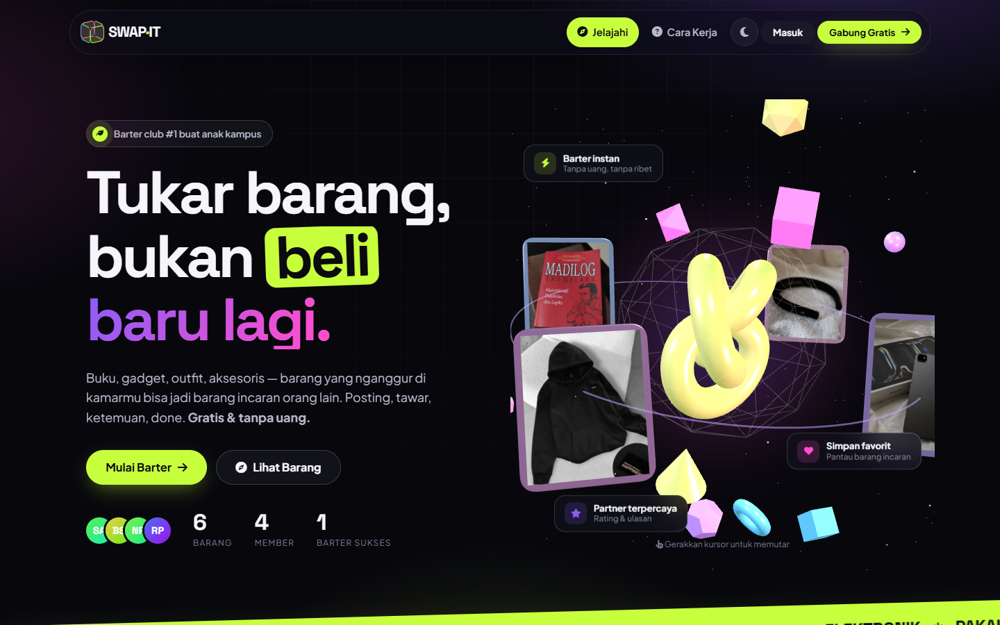

[Tentang](#-tentang) •
[Screenshot](#-screenshot) •
[Fitur](#-fitur) •
[Alur Barter](#-alur-barter) •
[Instalasi](#-instalasi) •
[Database](#-skema-database) •
[Routes](#-daftar-route) •
[Roadmap](#-roadmap)

</div>

---

## 📖 Tentang

Setiap semester, banyak mahasiswa punya barang yang masih bagus tapi sudah tidak terpakai: buku mata kuliah yang sudah lulus, hoodie yang jarang dipakai, gadget lama, aksesoris yang bosan. Di sisi lain, mahasiswa lain justru sedang mencari barang-barang itu, tapi budget terbatas.

**SWAP-IT** mempertemukan keduanya lewat sistem **barter**:

| Masalah | Solusi SWAP-IT |
| --- | --- |
| Barang nganggur menumpuk di kos | Posting barang dalam 1 menit, langsung tampil ke seluruh mahasiswa |
| Mau barang baru tapi uang terbatas | Tukar dengan barang milikmu — tanpa transaksi uang |
| Takut ketipu saat COD | Profil dengan rating & ulasan, riwayat barter, dan chat di dalam aplikasi |
| Repot koordinasi | Chat real-time, balasan cepat, dan tombol WhatsApp setelah tawaran diterima |
| Barang berakhir di tempat sampah | Setiap barter = satu barang terselamatkan 🌱 |

---

## 📸 Screenshot

> Semua screenshot memakai **data demo fiktif**.

### Beranda

| Mode gelap (default) | Mode terang |
| --- | --- |
|  | 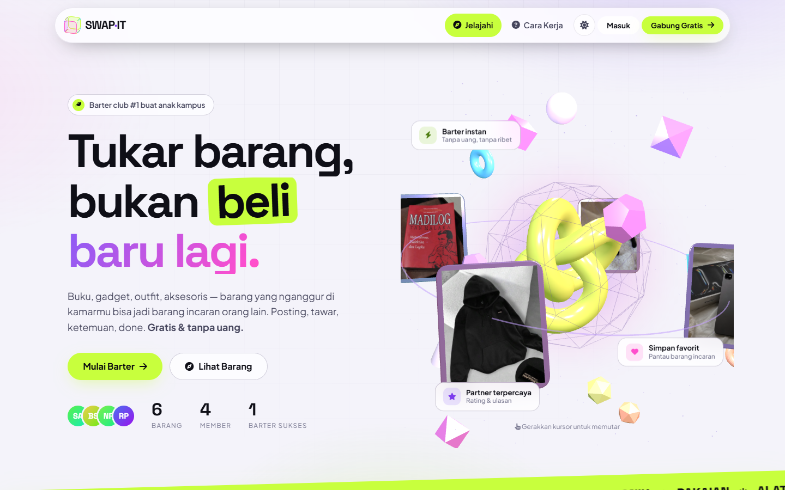 |

<details>
<summary><b>Lihat beranda satu halaman penuh</b> (kategori, daftar barang, cara kerja, CTA)</summary>

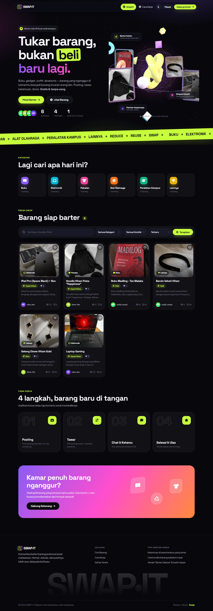

</details>

### Barang & Penawaran

| Detail barang | Penawaran masuk |
| --- | --- |
| 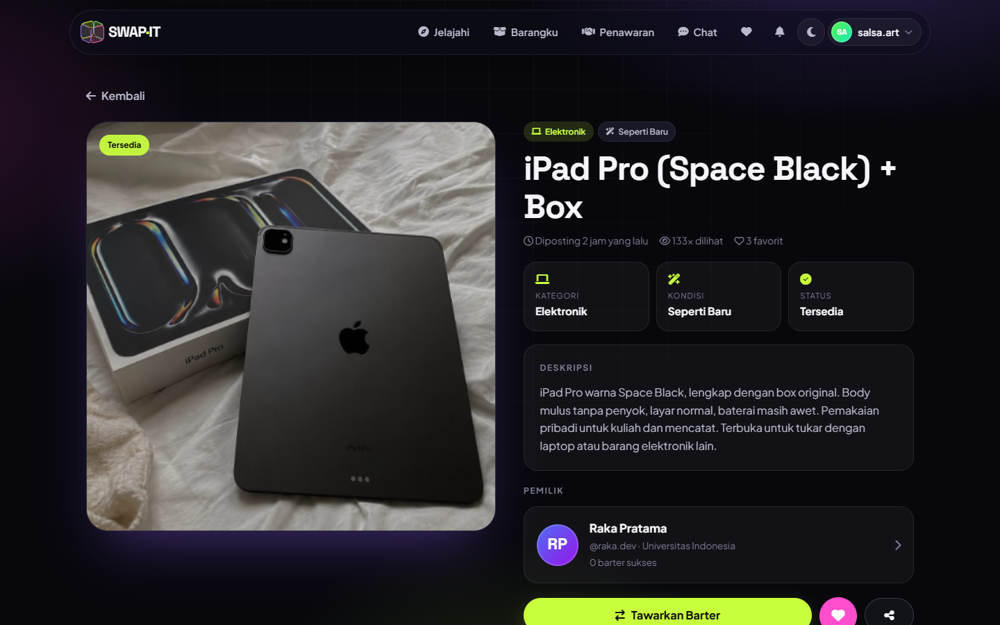 | 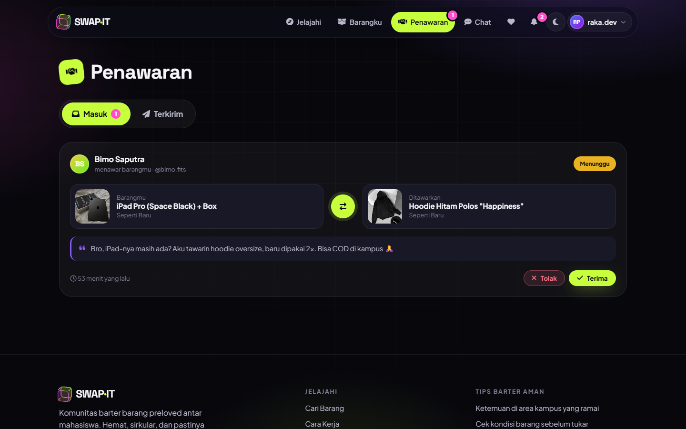 |

| Favorit (wishlist) | Barangku |
| --- | --- |
| 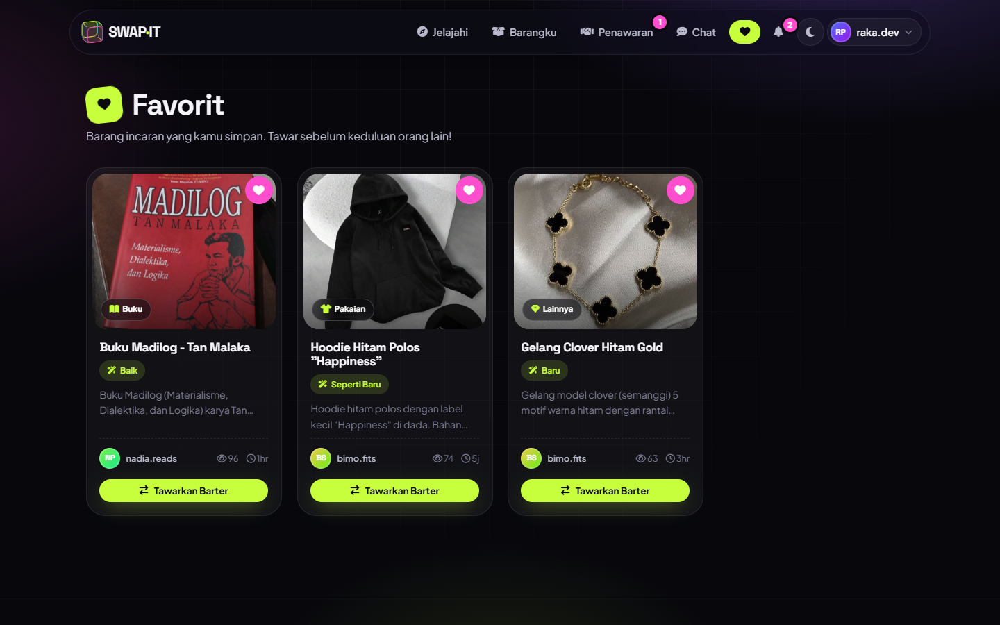 | 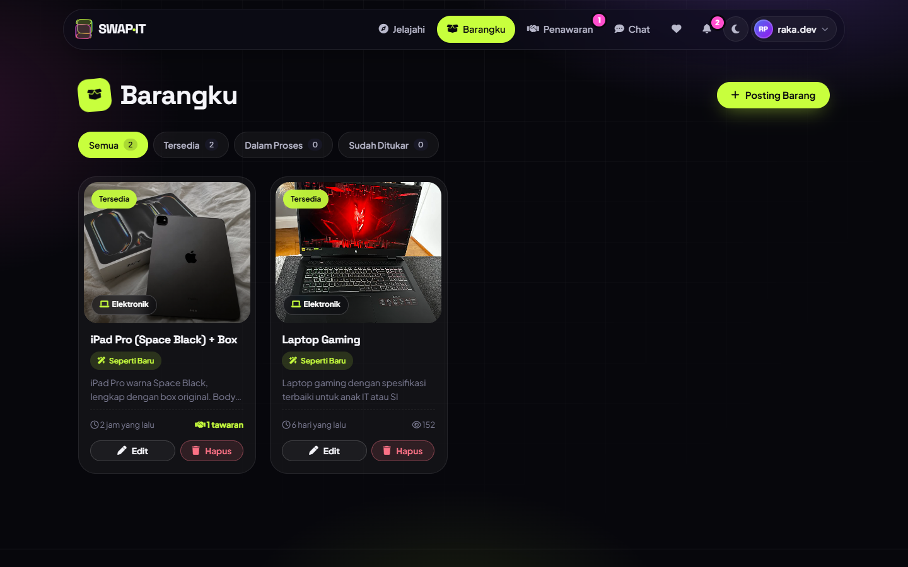 |

### Chat & Komunitas

| Chat barter | Daftar chat |
| --- | --- |
| 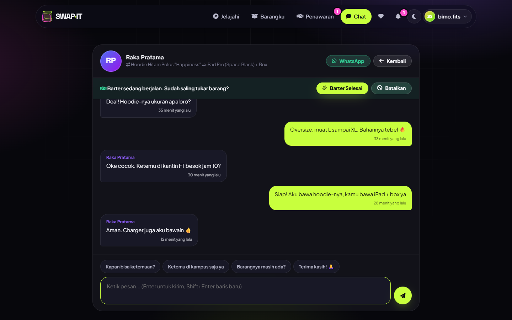 | 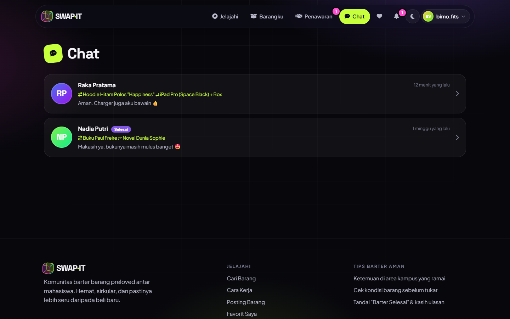 |

| Profil, rating & ulasan | Notifikasi |
| --- | --- |
| 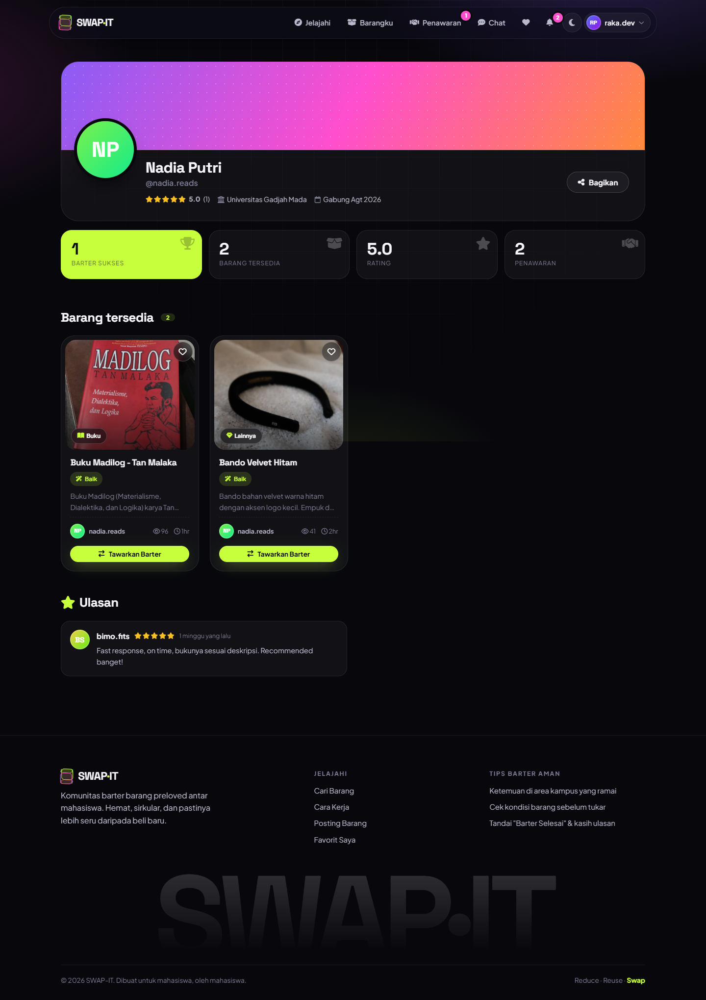 | 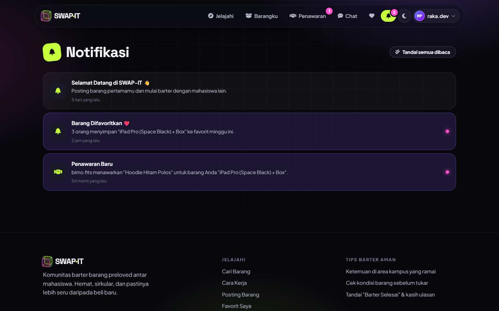 |

### Posting, Akun & Menu

| Posting barang | Menu pengguna |
| --- | --- |
| 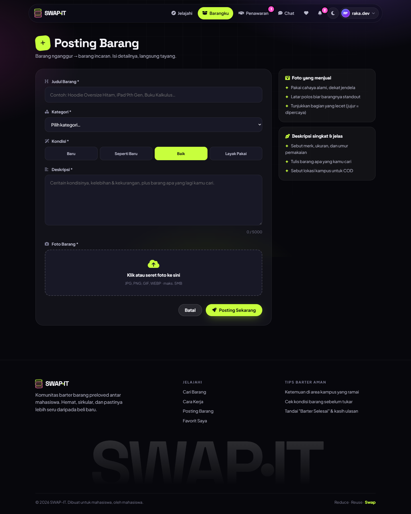 | 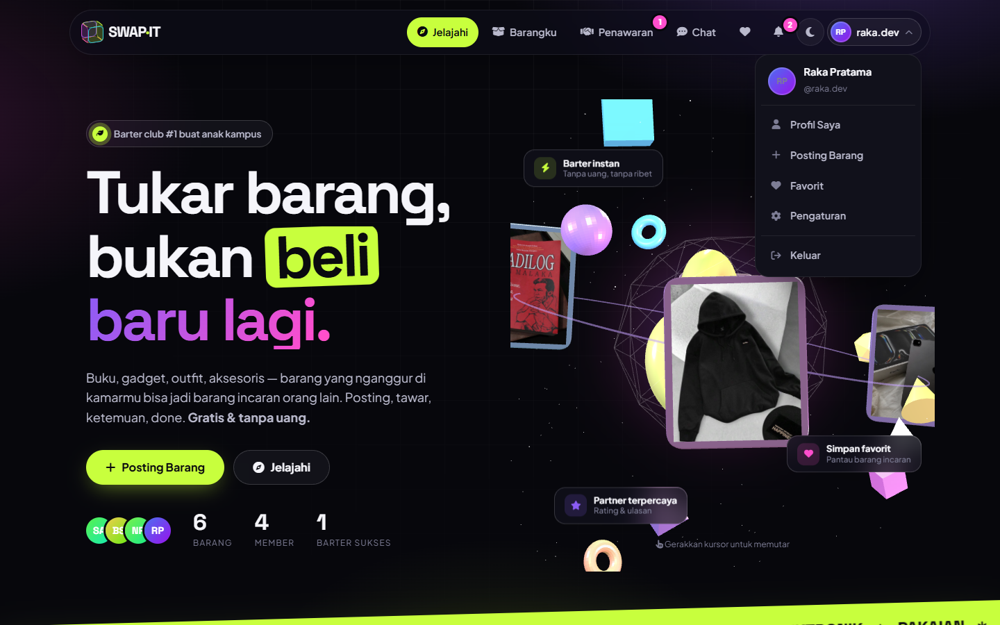 |

| Masuk | Daftar |
| --- | --- |
|  | 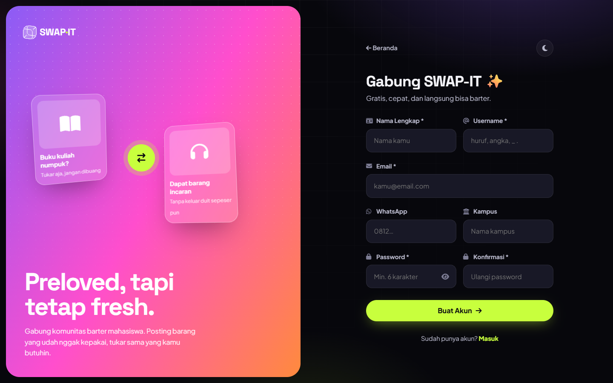 |

### Tampilan HP

<p align="center">
  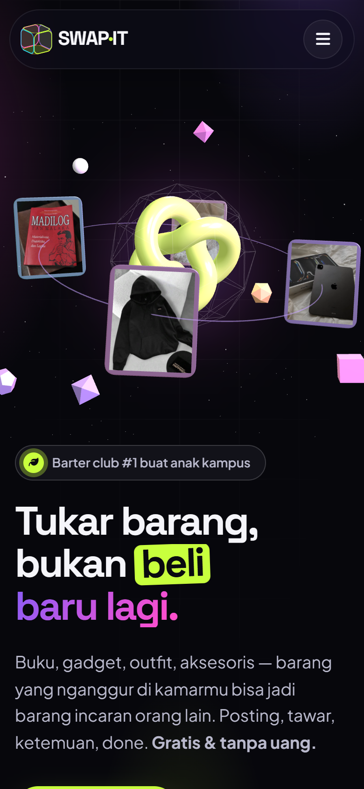
  &nbsp;
  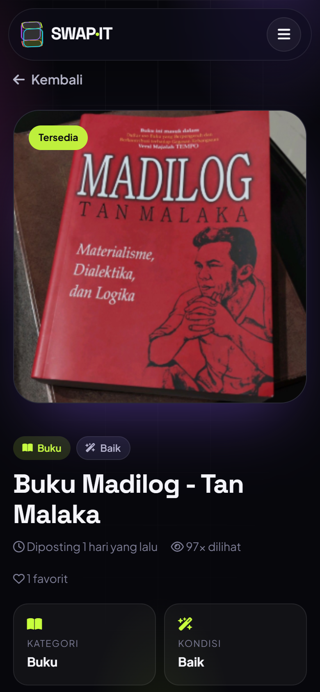
  &nbsp;
  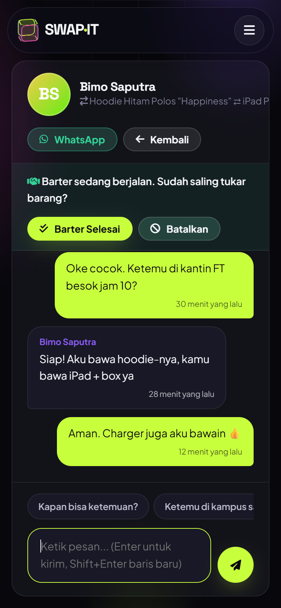
</p>

---

## ✨ Fitur

### 🧑‍🎓 Akun
- Registrasi dengan nama, username, email, nomor WhatsApp, dan kampus
- Login dengan opsi **"Ingat saya"**, logout aman
- **Lupa password**: link reset berlaku 2 jam (token di-hash SHA-256)
- Pengaturan profil & ganti password dengan indikator kekuatan password

### 📦 Barang
- Posting barang + foto (JPG/PNG/GIF/WEBP, maks. 5MB) dengan **drag & drop** dan preview
- 6 kategori: Buku, Elektronik, Pakaian, Alat Olahraga, Peralatan Kampus, Lainnya
- 4 kondisi: Baru, Seperti Baru, Baik, Layak Pakai
- Edit & hapus (hanya bila belum dalam proses barter)
- Status otomatis: **Tersedia → Dalam Proses → Sudah Ditukar**
- Penghitung **jumlah dilihat** (sekali per sesi, pemilik tidak dihitung)
- Halaman **Barangku** dengan filter status dan jumlah tawaran masuk

### 🔍 Jelajah
- Pencarian judul & deskripsi
- Filter kategori dan kondisi, kartu kategori dengan jumlah barang
- Urutan: Terbaru, Paling Populer, Terlama, Nama A-Z
- Pagination 12 barang per halaman

### 🤝 Barter
- Ajukan penawaran dengan memilih salah satu barangmu + pesan opsional
- Pemilik bisa **terima** atau **tolak**; pengirim bisa **tarik** penawaran
- Saat diterima, **penawaran lain untuk barang yang sama otomatis dibatalkan**
- Penawaran ganda untuk barang yang sama dicegah
- Setelah bertemu: tandai **Barter Selesai** atau **Batalkan** (barang kembali tersedia)

### 💬 Komunikasi
- **Chat real-time** (polling 3 detik) yang terbuka setelah penawaran diterima
- Balasan cepat ("Kapan bisa ketemuan?", dll.) dan Enter untuk kirim
- Tombol **WhatsApp** langsung ke partner barter
- Riwayat chat tetap bisa dibaca setelah barter selesai/dibatalkan
- **Notifikasi** untuk penawaran baru, diterima, ditolak, selesai, dan ulasan
- Badge jumlah penawaran, pesan, dan notifikasi di navbar yang diperbarui otomatis

### ❤️ Favorit & ⭐ Ulasan
- Simpan barang incaran dengan tombol hati (tanpa reload halaman)
- Setelah barter selesai, kedua pihak bisa memberi **rating 1–5 bintang + komentar**
- Rating rata-rata tampil di profil dan di halaman barang milik pengguna tersebut

### 👤 Profil Publik
- Statistik: barter sukses, barang tersedia, rating, penawaran
- Daftar barang tersedia, ulasan dari partner, dan riwayat barter (untuk pemilik profil)
- Tombol bagikan profil / barang (Web Share API atau salin link)

### 🎨 Tampilan
- Desain **dark-first** dengan glassmorphism, aksen lime-violet, plus **mode terang**
- **Hero 3D interaktif** (Three.js): foto barang asli mengorbit inti 3D, bisa diputar dengan drag, bereaksi terhadap kursor
- Kartu dengan **efek tilt 3D + kilau**, kartu "Cara Kerja" yang **membalik 3D**
- Animasi muncul saat scroll, angka statistik menghitung naik, efek hati "meledak"
- Responsif untuk HP, dan menghormati pengaturan **reduce motion**
- Cadangan otomatis ke kubus CSS 3D jika WebGL tidak tersedia

---

## 🔁 Alur Barter

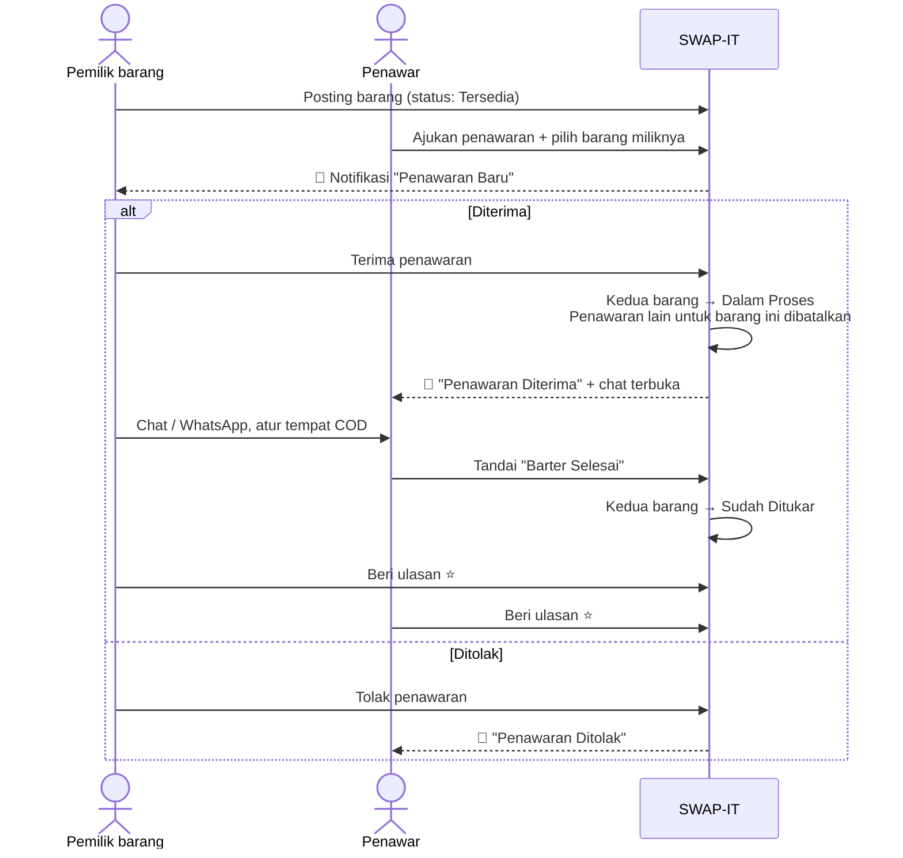

### Status penawaran

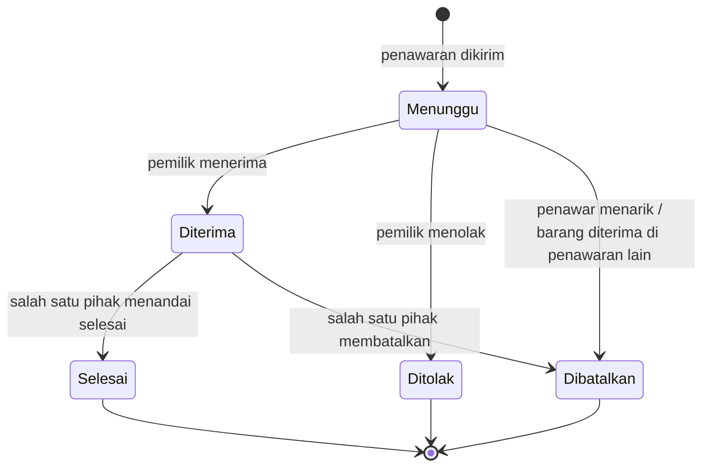

---

## 🛠 Tech Stack

| Lapisan | Teknologi |
| --- | --- |
| Backend | **Laravel 11** — Eloquent ORM, Blade, Validation, Rate Limiting, CSRF |
| Bahasa | PHP 8.2+ |
| Database | MySQL / MariaDB (XAMPP) |
| Frontend | Blade + **CSS murni** (design system sendiri, tanpa framework) + JavaScript vanilla |
| 3D | **Three.js r128** (hero) + CSS 3D transforms (tilt, flip, kubus) |
| Font & ikon | Space Grotesk, Plus Jakarta Sans, Font Awesome 6.5 |
| Session & cache | File driver |

---

## 🚀 Instalasi

### Persyaratan
- **PHP 8.2+** dengan ekstensi `pdo_mysql`, `mbstring`, `openssl`, `fileinfo`, `gd`
- **Composer** 2.x
- **MySQL 5.7+ / MariaDB 10.4+** — paling mudah pakai [XAMPP](https://www.apachefriends.org)
- Koneksi internet (untuk font, ikon, dan Three.js dari CDN)

### Langkah-langkah

```bash
# 1. Clone repository
git clone https://github.com/whympxx/swapit.git
cd swapit

# 2. Install dependency PHP
composer install

# 3. Siapkan konfigurasi
cp .env.example .env          # Windows: copy .env.example .env
php artisan key:generate
```

**4. Buat database.** Nyalakan MySQL di XAMPP, buka phpMyAdmin, lalu buat database bernama `swapit_db` (collation `utf8mb4_unicode_ci`). Atau lewat terminal:

```bash
mysql -u root -e "CREATE DATABASE swapit_db CHARACTER SET utf8mb4 COLLATE utf8mb4_unicode_ci"
```

```bash
# 5. Buat tabel
php artisan migrate

# 6. Jalankan server
php artisan serve
```

Buka **http://localhost:8000**, daftar akun baru, lalu mulai posting barang. 🎉

> 💡 Port 8000 sudah dipakai? Jalankan `php artisan serve --port=8001`.

### Konfigurasi `.env` penting

| Kunci | Default | Keterangan |
| --- | --- | --- |
| `APP_URL` | `http://localhost:8000` | URL aplikasi |
| `APP_TIMEZONE` | `Asia/Jakarta` | Zona waktu PHP |
| `DB_DATABASE` | `swapit_db` | Nama database |
| `DB_USERNAME` / `DB_PASSWORD` | `root` / *(kosong)* | Kredensial MySQL (default XAMPP) |
| `DB_TIMEZONE` | `+07:00` | Zona waktu koneksi MySQL (harus sama dengan PHP) |
| `MAIL_MAILER` | `log` | Ganti ke `smtp` untuk mengirim email reset password sungguhan |

### Mode pengembangan
- Email reset password ditulis ke `storage/logs/laravel.log` (driver `log`).
- Selama `APP_DEBUG=true`, link reset juga ditampilkan langsung di halaman **Lupa Password**.
- Untuk email sungguhan (misal Gmail SMTP), isi `MAIL_MAILER=smtp`, `MAIL_HOST`, `MAIL_PORT`, `MAIL_USERNAME`, `MAIL_PASSWORD`, dan `MAIL_FROM_ADDRESS`.

### Troubleshooting

| Masalah | Solusi |
| --- | --- |
| `SQLSTATE[HY000] [2002]` | MySQL belum jalan — nyalakan di XAMPP Control Panel |
| `Unknown database 'swapit_db'` | Buat database dulu (langkah 4) |
| Foto barang tidak muncul | Pastikan folder `public/uploads/items/` ada dan bisa ditulis |
| Halaman error 419 | Sesi kedaluwarsa — muat ulang halaman lalu coba lagi |
| Hero 3D tidak tampil | Cek koneksi internet (Three.js dari CDN); browser tanpa WebGL otomatis memakai kubus CSS |
| Perubahan tampilan tidak terlihat | `php artisan view:clear` lalu hard refresh (Ctrl+F5) |

---

## 🗄 Skema Database

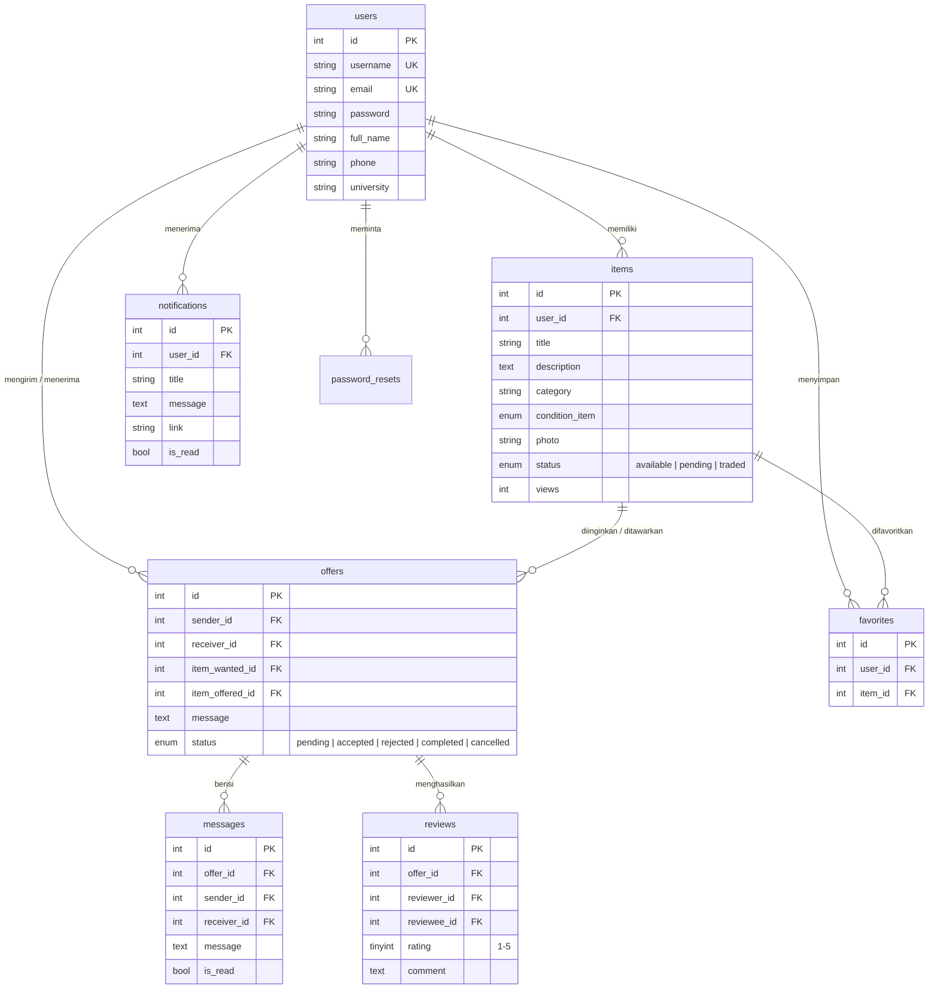

> Migration bersifat **idempotent**: aman dijalankan pada database lama (hanya membuat tabel/kolom yang belum ada) maupun database kosong.

---

## 🧭 Daftar Route

<details>
<summary><b>Lihat semua route</b></summary>

| Method | URL | Keterangan | Akses |
| --- | --- | --- | --- |
| GET | `/` | Beranda, pencarian & filter | Publik |
| GET | `/items/{item}` | Detail barang | Publik |
| GET | `/users/{user}` | Profil publik | Publik |
| GET/POST | `/login`, `/register` | Masuk & daftar | Tamu |
| GET/POST | `/forgot-password`, `/reset-password/{token}` | Reset password | Tamu |
| POST | `/logout` | Keluar | Login |
| GET | `/my-items` | Barangku | Login |
| GET/POST | `/items/create`, `/items` | Posting barang | Login |
| GET/PUT/DELETE | `/items/{item}/edit`, `/items/{item}` | Edit & hapus barang | Pemilik |
| POST | `/items/{item}/favorite` | Simpan / hapus favorit (JSON) | Login |
| GET | `/favorites` | Daftar favorit | Login |
| GET | `/offers` | Penawaran masuk & terkirim | Login |
| GET/POST | `/items/{item}/offer` | Buat penawaran | Login |
| POST | `/offers/{offer}/accept` · `reject` · `cancel` | Respon penawaran | Pihak terkait |
| POST | `/offers/{offer}/complete` · `cancel-deal` | Selesaikan / batalkan barter | Pihak terkait |
| POST | `/offers/{offer}/review` | Beri ulasan | Pihak terkait |
| GET | `/chat`, `/chat/{offer}` | Daftar & ruang chat | Pihak terkait |
| GET/POST | `/chat/{offer}/messages` | Ambil & kirim pesan (JSON) | Pihak terkait |
| GET | `/notifications` | Daftar notifikasi | Login |
| GET | `/api/unread-counts` | Jumlah badge navbar (JSON) | Login |
| GET/PUT | `/profile`, `/settings`, `/settings/password` | Profil & pengaturan | Login |

</details>

---

## 🗂 Struktur Proyek

```
swapit/
├── app/
│   ├── Http/Controllers/
│   │   ├── HomeController.php          # beranda, filter, statistik
│   │   ├── AuthController.php          # login, register, logout
│   │   ├── PasswordResetController.php # lupa & reset password
│   │   ├── ItemController.php          # CRUD barang, penghitung dilihat
│   │   ├── OfferController.php         # alur penawaran & barter
│   │   ├── ChatController.php          # chat & polling pesan
│   │   ├── FavoriteController.php      # wishlist
│   │   ├── ReviewController.php        # rating & ulasan
│   │   ├── NotificationController.php
│   │   └── ProfileController.php
│   ├── Models/                         # User, Item, Offer, Message, Review, Favorite, UserNotification
│   └── Providers/AppServiceProvider.php # locale ID + badge navbar
├── database/migrations/                # skema tabel (idempotent)
├── lang/id/validation.php              # pesan validasi Bahasa Indonesia
├── public/
│   ├── assets/css/style.css            # design system (dark/light, 3D, responsif)
│   ├── assets/js/main.js               # interaksi: tema, favorit, tilt, animasi
│   ├── assets/js/hero3d.js             # adegan Three.js di beranda
│   └── uploads/items/                  # foto barang (tidak di-commit)
├── resources/views/
│   ├── layouts/                        # app & auth
│   ├── partials/                       # navbar, footer, item-card, avatar, stars
│   ├── items/ offers/ chat/ favorites/ profile/ notifications/ auth/ errors/
│   └── home.blade.php
├── routes/web.php
└── docs/screenshots/                   # gambar untuk README
```

---

## 🔐 Keamanan

- **CSRF token** di semua form dan request AJAX; aksi yang mengubah data hanya lewat **POST/PUT/DELETE**
- **Otorisasi** di setiap aksi: hanya pemilik / pihak terkait yang bisa mengedit, merespons, atau membuka chat
- **Validasi input** server-side + whitelist kategori & kondisi, cek tipe file gambar asli
- **Output di-escape** oleh Blade, dan chat dirender dengan `textContent` — aman dari XSS
- **Transaksi database + row lock** saat menerima / menyelesaikan barter (mencegah barang diterima dua kali)
- **Rate limiting** untuk login, registrasi, reset password, kirim chat, dan favorit
- Password di-hash dengan **bcrypt**, token reset di-hash **SHA-256** dan kedaluwarsa 2 jam
- Session di-regenerate saat login, cookie `HttpOnly` + `SameSite=Lax`

---

## 🎨 Design System

| Token | Gelap | Terang |
| --- | --- | --- |
| Latar | `#07070C` | `#F4F3FA` |
| Aksen utama (lime) | `#C8FF3D` | `#C8FF3D` |
| Violet | `#8B5CF6` | `#7C3AED` |
| Pink | `#FF4ECD` | `#FF4ECD` |
| Gradien | violet → pink → oranye | sama |
| Font judul | Space Grotesk | |
| Font isi | Plus Jakarta Sans | |

Tema dipilih lewat tombol 🌙/☀️ di navbar dan disimpan di browser.

---

## 🗺 Roadmap

- [x] Alur barter lengkap (tawar → terima → selesai / batal)
- [x] Chat real-time + WhatsApp
- [x] Notifikasi
- [x] Favorit / wishlist
- [x] Rating & ulasan
- [x] Mode gelap / terang + tampilan 3D
- [ ] Upload lebih dari satu foto per barang
- [ ] Chat dengan WebSocket (Laravel Reverb) menggantikan polling
- [ ] Filter berdasarkan kampus / lokasi COD
- [ ] Laporan pengguna & moderasi admin
- [ ] Verifikasi email mahasiswa (domain `.ac.id`)
- [ ] PWA / aplikasi mobile

---

## 🤝 Kontribusi

1. Fork repo ini
2. Buat branch fitur: `git checkout -b fitur/nama-fitur`
3. Commit perubahan: `git commit -m "feat: tambah nama-fitur"`
4. Push: `git push origin fitur/nama-fitur`
5. Buka Pull Request

Laporan bug dan ide fitur bisa lewat [Issues](https://github.com/whympxx/swapit/issues).

---

## 📄 Lisensi

Dirilis di bawah lisensi [MIT](LICENSE).

> Versi sebelumnya (aplikasi mobile Flutter) masih tersedia di riwayat commit repo ini.

---

<div align="center">

**SWAP·IT** — Reduce · Reuse · Swap 🌱

Made by [whympxx](https://github.com/whympxx).

</div>
