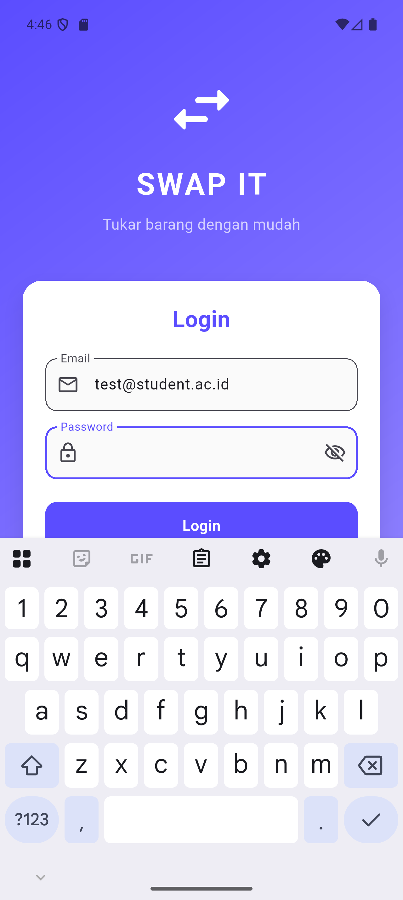
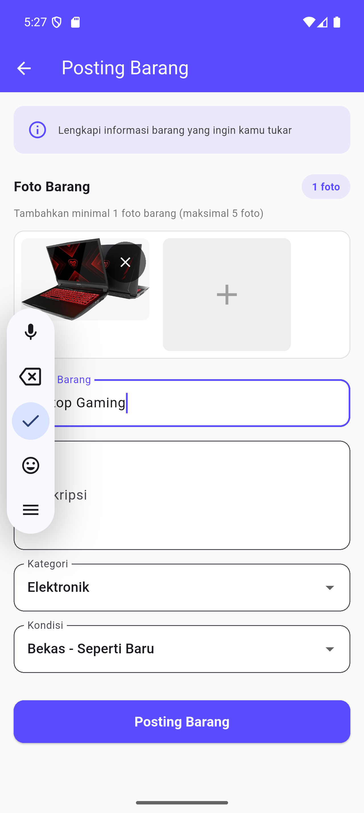

<div align="center">

# 🔄 Swap It

### Student Item Exchange Platform

*Aplikasi mobile berbasis Flutter untuk memudahkan mahasiswa dalam tukar menukar barang*

[](https://flutter.dev)
[](https://dart.dev)
[](LICENSE)
[](https://github.com/whympxx/swapit)

[Features](#-features) • [Tech Stack](#-tech-stack) • [Installation](#-installation) • [Screenshots](#-screenshots) • [Roadmap](#-roadmap)

</div>

---

## 📱 Overview

Swap It adalah aplikasi mobile yang dirancang khusus untuk komunitas mahasiswa yang ingin melakukan pertukaran barang dengan mudah dan aman. Dengan antarmuka yang intuitif dan fitur-fitur lengkap, mahasiswa dapat dengan cepat menemukan barang yang mereka butuhkan dan menawarkan barang mereka untuk ditukar.

## ✨ Features

<table>
<tr>
<td width="50%">

### 🔐 Authentication
- **Secure Login** - Email & password authentication
- **Student Registration** - Sign up with NIM (Student ID)
- **Session Management** - Automatic logout & session control

### 🏠 Home & Discovery
- **Grid Layout** - Beautiful item display
- **Smart Search** - Find items quickly
- **Category Filters** - Electronics, Fashion, Books, Sports, etc.
- **Quick Navigation** - Bottom navigation bar

### 👤 User Profile
- **Student Info** - Name, NIM, Email, Phone, Address
- **Quick Actions** - Direct email/call links
- **My Items** - Quick access to posted items

### 📝 Item Posting
- **Complete Form** - Title, description, category, condition
- **Multi-Photo Upload** - Add multiple images
- **Form Validation** - Ensures data quality

</td>
<td width="50%">

### 📦 Item Details
- **Comprehensive View** - All item information
- **Owner Info** - Contact seller details
- **Quick Actions** - Make offer & send message buttons

### 🤝 Offer System
- **Offer Management** - Send & receive offers
- **Status Tracking** - Pending, Accepted, Rejected
- **Offer Creation** - Easy form to make offers

### 💬 Real-time Messaging
- **Chat Interface** - Modern messaging UI
- **Conversation List** - All your chats in one place
- **Notifications** - Badge alerts for new messages

### ⚙️ Settings
- **Profile Editor** - Update your information
- **Security** - Change password
- **Preferences** - Notifications & language
- **Support** - Help & about sections

</td>
</tr>
</table>

## 🛠️ Tech Stack

| Category | Technology |
|----------|------------|
| **Framework** |  |
| **Language** |  |
| **State Management** | Provider Pattern |
| **UI/UX** | Material Design 3 |

### 📦 Key Dependencies

```yaml
dependencies:
  google_fonts: ^6.3.3        # Beautiful typography
  image_picker: ^1.0.4        # Image upload functionality
  shared_preferences: ^2.2.2  # Local data persistence
  intl: ^0.18.1               # Internationalization & date formatting
  provider: ^6.1.1            # State management
  url_launcher: ^6.2.1        # External URL handling
  cached_network_image: ^3.3.0 # Optimized image loading
  http: ^1.1.0                # HTTP requests
```

## 📁 Project Structure

```
lib/
├── main.dart                 # Entry point aplikasi
├── models/                   # Data models
│   ├── user.dart
│   ├── item.dart
│   ├── offer.dart
│   └── message.dart
├── providers/                # State management
│   ├── auth_provider.dart
│   └── item_provider.dart
└── screens/                  # UI Screens
    ├── login_screen.dart
    ├── register_screen.dart
    ├── home_screen.dart
    ├── profile_screen.dart
    ├── item_detail_screen.dart
    ├── posting_screen.dart
    ├── penawaran_screen.dart
    ├── buat_penawaran_screen.dart
    ├── barang_saya_screen.dart
    ├── pesan_screen.dart
    ├── list_pesan_screen.dart
    └── pengaturan_screen.dart
```

## 🚀 Installation

### Prerequisites

Ensure you have the following installed:
- 🐳 **Flutter SDK** `>=3.0.0`
- 💻 **IDE**: Android Studio / VS Code with Flutter extensions
- 📱 **Device**: Android/iOS emulator or physical device

### Quick Start

1. **Clone the repository**
   ```bash
   git clone https://github.com/whympxx/swapit.git
   cd swapit
   ```

2. **Install dependencies**
   ```bash
   flutter pub get
   ```

3. **Run the app**
   ```bash
   flutter run
   ```

### Building for Production

**Android APK**
```bash
flutter build apk --release
```

**Android App Bundle (for Play Store)**
```bash
flutter build appbundle --release
```

**iOS** (macOS only)
```bash
flutter build ios --release
```

### 🔑 Demo Credentials

For testing purposes, use any credentials:
- **Email**: `any@email.com`
- **Password**: `minimum 6 characters`

> ⚠️ **Note**: This app uses dummy data for demonstration. Production deployment requires backend integration.

## 📸 Screenshots

<div align="center">

### Modern UI with Material Design 3

| Home Screen | Item Details | Messaging |
|-------------|--------------|------------|
|  |  | *Coming Soon* |

**Design Highlights:**
- 🎨 **Theme Color**: Purple `#5B4DFF`
- ✨ **User-Friendly**: Intuitive navigation & clean interface
- 📱 **Responsive**: Adapts to all screen sizes
- 🎆 **Modern**: Material Design 3 components

</div>

## 🗺️ Roadmap

### Phase 1: Backend Integration 🔧
- [ ] REST API implementation
- [ ] Database setup (PostgreSQL/MongoDB)
- [ ] JWT Authentication
- [ ] Cloud storage for images

### Phase 2: Real-time Features ⚡
- [ ] WebSocket integration for messaging
- [ ] Push notifications (FCM)
- [ ] Real-time offer updates
- [ ] Online status indicators

### Phase 3: Enhanced Features 🌟
- [ ] Rating & review system
- [ ] Swap history & analytics
- [ ] Wishlist functionality
- [ ] Report & moderation system
- [ ] Advanced search with AI
- [ ] Location-based filtering

### Phase 4: Future Enhancements 🚀
- [ ] Payment gateway integration (optional)
- [ ] Virtual wallet system
- [ ] Gamification (badges, levels)
- [ ] Social sharing features
- [ ] Multi-language support (English, Indonesian)

## 🛡️ Development Notes

> **Current Status**: Demo/Prototype Version

- 📊 **Data**: Using dummy/mock data for simulation
- 🔒 **Auth**: Local authentication (needs OAuth/JWT for production)
- 📷 **Images**: Placeholder images (needs cloud storage integration)
- 💬 **Messaging**: UI-only (needs WebSocket/Firebase for real-time)
- 🏛️ **Backend**: No backend yet (API integration required)

## 🤝 Contributing

Contributions are welcome! Here's how you can help:

1. **Fork** the repository
2. **Create** a new branch (`git checkout -b feature/AmazingFeature`)
3. **Commit** your changes (`git commit -m 'Add some AmazingFeature'`)
4. **Push** to the branch (`git push origin feature/AmazingFeature`)
5. **Open** a Pull Request

Please read [CONTRIBUTING.md](CONTRIBUTING.md) for details on our code of conduct.

## 📝 License

This project is licensed under the **MIT License** - see the [LICENSE](LICENSE) file for details.

© 2024 Swap It. All rights reserved.

## 💬 Support & Contact

<div align="center">

### Need Help?

If you have any questions, issues, or suggestions:

[](https://github.com/whympxx/swapit/issues)
[](mailto:support@swapit.com)

**Repository**: [github.com/whympxx/swapit](https://github.com/whympxx/swapit)

</div>

## ⭐ Show Your Support

Give a ⭐ if this project helped you!

---

<div align="center">

### Made with ❤️ using Flutter

**Swap It** - Making Student Item Exchange Easy & Fun!

[Back to Top](#-swap-it)

</div>

Made by [whympxx](https://github.com/whympxx).
