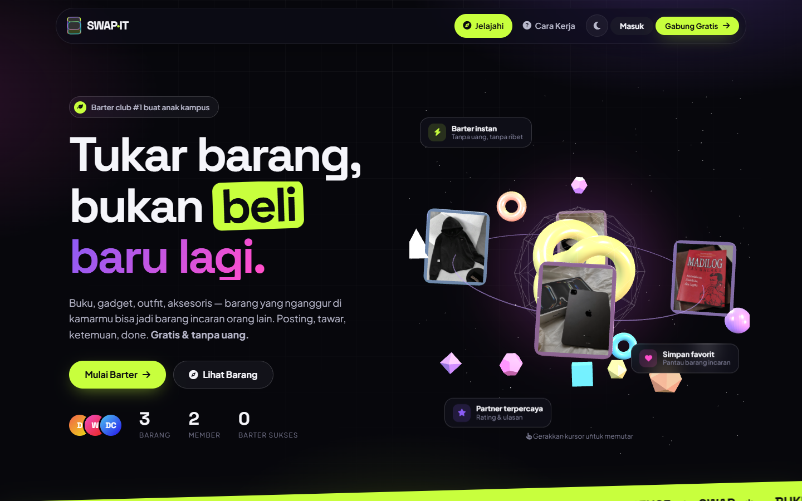
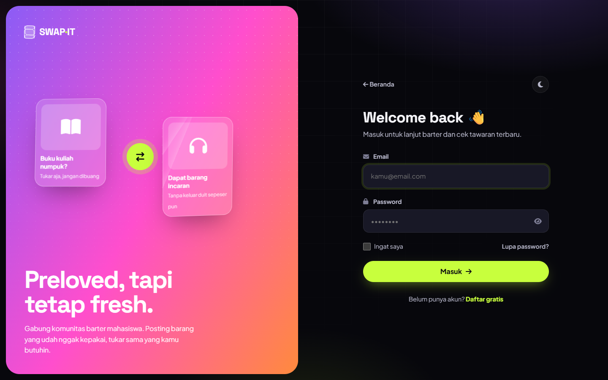

<div align="center">

# 🔄 SWAP·IT

### Barter barang preloved antar mahasiswa

*Tukar barang, bukan beli baru lagi.* Platform web untuk mahasiswa menukar buku, gadget, outfit, dan aksesoris yang sudah tidak terpakai — tanpa uang.

[](https://laravel.com)
[](https://php.net)
[](https://mariadb.org)
[](https://threejs.org)
[](LICENSE)

[Fitur](#-fitur) • [Screenshot](#-screenshot) • [Instalasi](#-instalasi) • [Struktur](#-struktur-proyek)

</div>

---

## 📸 Screenshot

| Beranda (hero 3D) | Masuk |
| --- | --- |
|  |  |

## ✨ Fitur

**Barter**
- Posting, edit, dan hapus barang dengan foto (JPG/PNG/GIF/WEBP, maks. 5MB)
- Cari barang + filter kategori & kondisi, urutan Terbaru / Paling Populer / Nama
- Ajukan penawaran barter, tarik, terima, atau tolak
- Alur lengkap: **Diterima → Barter Selesai** (barang jadi "Sudah Ditukar") atau **Batalkan** (barang kembali tersedia)
- Saat satu penawaran diterima, penawaran lain untuk barang yang sama dibatalkan otomatis

**Komunitas**
- Chat real-time (polling) dengan balasan cepat + tombol WhatsApp ke partner barter
- ❤️ **Favorit / wishlist** untuk menyimpan barang incaran
- ⭐ **Rating & ulasan** setelah barter selesai, tampil di profil dan halaman barang
- Profil publik dengan statistik, ulasan, dan riwayat barter
- Notifikasi + badge di navbar yang diperbarui otomatis
- Jumlah dilihat per barang dan tombol bagikan

**Tampilan**
- Desain modern dark-first dengan glassmorphism, plus mode terang
- Hero 3D interaktif (Three.js): foto barang mengorbit, bisa diputar dengan drag
- Kartu dengan efek tilt 3D, kartu "Cara Kerja" yang membalik, animasi saat scroll
- Responsif untuk HP, menghormati pengaturan *reduce motion*

**Keamanan**
- CSRF di semua aksi, aksi penting hanya lewat POST
- Validasi input + whitelist kategori/kondisi, cek tipe file gambar
- Output di-escape (aman dari XSS), transaksi database untuk aksi barter
- Rate limit untuk login, registrasi, reset password, chat, dan favorit

## 🚀 Instalasi

Persyaratan: **PHP 8.2+**, **Composer**, **MySQL/MariaDB** (XAMPP cukup).

```bash
git clone https://github.com/whympxx/swapit.git
cd swapit
composer install
cp .env.example .env          # default: MySQL root tanpa password, database swapit_db
php artisan key:generate
```

Buat database `swapit_db`, lalu:

```bash
php artisan migrate
php artisan serve             # buka http://localhost:8000
```

> Migration dibuat aman untuk database lama: hanya membuat tabel/kolom yang belum ada.

### Mode pengembangan
- Email reset password memakai driver `log` (`storage/logs/laravel.log`).
- Selama `APP_DEBUG=true`, link reset juga ditampilkan langsung di halaman Lupa Password.
- Untuk email sungguhan, isi pengaturan `MAIL_*` di `.env`.

## 🗂 Struktur Proyek

| Bagian | Lokasi |
| --- | --- |
| Routes | `routes/web.php` |
| Controller | `app/Http/Controllers/` — Home, Auth, PasswordReset, Item, Offer, Chat, Notification, Profile, Favorite, Review |
| Model | `app/Models/` — User, Item, Offer, Message, UserNotification, Favorite, Review |
| Tampilan (Blade) | `resources/views/` |
| CSS, JS & adegan 3D | `public/assets/css/style.css`, `public/assets/js/main.js`, `public/assets/js/hero3d.js` |
| Migration | `database/migrations/` |
| Foto barang | `public/uploads/items/` (tidak ikut di-commit) |

## 🛠 Tech Stack

- **Backend:** Laravel 11 (Eloquent, Blade, validation, throttle)
- **Database:** MySQL / MariaDB
- **Frontend:** Blade + CSS murni (custom design system) + JavaScript vanilla
- **3D:** Three.js r128
- **Font & ikon:** Space Grotesk, Plus Jakarta Sans, Font Awesome 6

> Versi sebelumnya (aplikasi mobile Flutter) masih tersedia di riwayat commit repo ini.

## 📄 Lisensi

[MIT](LICENSE)

---

<div align="center">

**SWAP·IT** — Reduce · Reuse · Swap 🌱

Made by [whympxx](https://github.com/whympxx).

</div>
